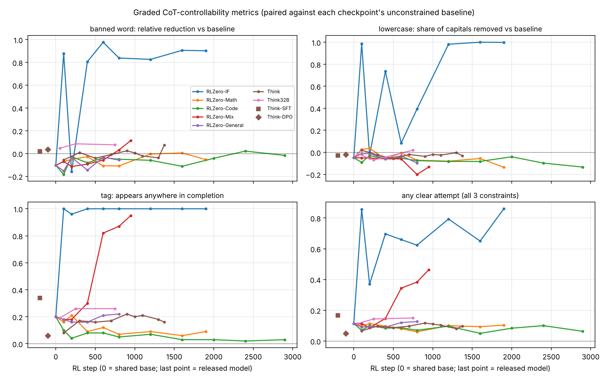

# Graded CoT-controllability metrics (paired vs. unconstrained baseline)

See `src/graded_metrics.py` docstring for definitions. All values are means over 100 questions per checkpoint.

| pipeline | revision | word rel. reduction | word density reduction | word zero-use | uses (constr./base) | lowercase gap closed | lowercase attempt | tag start | tag ≤200 chars | tag anywhere | any attempt | words (constr./base) |
|---|---|---|---|---|---|---|---|---|---|---|---|---|
| Olmo-3-1025-7B | main | -0.10 | -0.08 | 5% | 14.6 / 13.7 | -0.05 | 2% | 1% | 1% | 20% | 11% | 573 / 546 |
| Olmo-3-1125-32B | main | -0.11 | -0.11 | 1% | 12.4 / 12.4 | -0.03 | 0% | 0% | 0% | 2% | 4% | 518 / 527 |
| RLZero-Code | step_100 | -0.18 | -0.19 | 4% | 17.1 / 14.9 | -0.09 | 1% | 0% | 0% | 10% | 7% | 640 / 632 |
| RLZero-Code | step_200 | -0.03 | -0.08 | 4% | 12.9 / 14.8 | -0.03 | 3% | 0% | 0% | 4% | 10% | 580 / 616 |
| RLZero-Code | step_400 | -0.08 | -0.07 | 3% | 13.7 / 14.3 | -0.06 | 1% | 0% | 0% | 8% | 8% | 573 / 586 |
| RLZero-Code | step_600 | -0.04 | -0.08 | 5% | 14.1 / 15.1 | -0.05 | 0% | 0% | 0% | 8% | 9% | 597 / 597 |
| RLZero-Code | step_800 | -0.05 | -0.02 | 3% | 13.9 / 14.9 | -0.08 | 1% | 0% | 0% | 5% | 7% | 615 / 603 |
| RLZero-Code | step_1200 | -0.06 | -0.05 | 3% | 15.1 / 16.1 | -0.08 | 1% | 0% | 0% | 7% | 10% | 649 / 642 |
| RLZero-Code | step_1600 | -0.11 | -0.11 | 5% | 13.7 / 14.0 | -0.08 | 2% | 0% | 0% | 3% | 5% | 631 / 616 |
| RLZero-Code | step_2000 | -0.04 | -0.04 | 5% | 12.8 / 14.4 | -0.04 | 4% | 0% | 0% | 3% | 8% | 588 / 592 |
| RLZero-Code | step_2400 | 0.02 | 0.02 | 9% | 13.3 / 14.4 | -0.10 | 3% | 0% | 0% | 2% | 10% | 581 / 601 |
| RLZero-Code | main | -0.02 | -0.06 | 8% | 14.9 / 15.4 | -0.13 | 1% | 0% | 0% | 3% | 6% | 620 / 625 |
| RLZero-General | step_100 | -0.15 | -0.09 | 4% | 14.0 / 13.3 | -0.01 | 0% | 0% | 0% | 18% | 9% | 575 / 549 |
| RLZero-General | step_200 | -0.03 | -0.04 | 4% | 14.6 / 14.9 | -0.01 | 2% | 0% | 0% | 16% | 10% | 592 / 602 |
| RLZero-General | step_400 | -0.15 | -0.11 | 3% | 14.8 / 13.8 | -0.06 | 0% | 0% | 0% | 16% | 9% | 624 / 594 |
| RLZero-General | step_600 | -0.03 | -0.03 | 3% | 14.8 / 14.8 | -0.03 | 1% | 0% | 0% | 21% | 12% | 607 / 587 |
| RLZero-General | main | -0.06 | -0.04 | 3% | 13.0 / 12.9 | -0.10 | 2% | 0% | 0% | 22% | 13% | 576 / 551 |
| RLZero-IF | step_100 | 0.88 | 0.81 | 81% | 0.2 / 3.3 | 0.99 | 79% | 100% | 100% | 100% | 86% | 11 / 149 |
| RLZero-IF | step_200 | -0.16 | -0.19 | 4% | 14.3 / 12.9 | -0.03 | 1% | 90% | 90% | 96% | 37% | 461 / 532 |
| RLZero-IF | step_400 | 0.81 | 0.65 | 80% | 0.3 / 1.3 | 0.74 | 63% | 100% | 100% | 100% | 70% | 13 / 58 |
| RLZero-IF | step_600 | 0.98 | 0.97 | 97% | 0.0 / 8.8 | 0.08 | 6% | 100% | 100% | 100% | 66% | 3 / 395 |
| RLZero-IF | step_800 | 0.84 | 0.76 | 77% | 0.4 / 4.7 | 0.39 | 12% | 100% | 100% | 100% | 62% | 13 / 210 |
| RLZero-IF | step_1200 | 0.83 | 0.73 | 77% | 0.3 / 2.8 | 0.98 | 73% | 100% | 100% | 100% | 79% | 13 / 124 |
| RLZero-IF | step_1600 | 0.91 | 0.87 | 91% | 0.1 / 1.6 | 1.00 | 36% | 98% | 100% | 100% | 65% | 7 / 72 |
| RLZero-IF | main | 0.90 | 0.86 | 92% | 0.1 / 1.4 | 1.00 | 98% | 99% | 100% | 100% | 86% | 7 / 62 |
| RLZero-Math | step_100 | -0.07 | -0.07 | 5% | 14.2 / 14.1 | 0.02 | 0% | 0% | 0% | 16% | 10% | 580 / 581 |
| RLZero-Math | step_200 | -0.05 | -0.05 | 5% | 14.5 / 14.0 | 0.04 | 0% | 0% | 0% | 21% | 11% | 588 / 594 |
| RLZero-Math | step_400 | -0.03 | -0.05 | 2% | 15.1 / 17.2 | -0.06 | 0% | 0% | 0% | 9% | 10% | 619 / 641 |
| RLZero-Math | step_600 | -0.11 | -0.14 | 5% | 15.2 / 13.9 | -0.01 | 1% | 0% | 0% | 12% | 8% | 626 / 629 |
| RLZero-Math | step_800 | -0.11 | -0.08 | 4% | 16.6 / 15.4 | -0.07 | 1% | 0% | 0% | 7% | 6% | 641 / 652 |
| RLZero-Math | step_1200 | -0.00 | -0.00 | 3% | 15.7 / 16.8 | -0.08 | 3% | 0% | 0% | 9% | 10% | 668 / 681 |
| RLZero-Math | step_1600 | 0.01 | -0.00 | 4% | 15.0 / 15.8 | -0.06 | 5% | 0% | 0% | 6% | 9% | 675 / 678 |
| RLZero-Math | main | -0.05 | -0.06 | 4% | 16.2 / 16.0 | -0.14 | 2% | 0% | 0% | 9% | 10% | 679 / 690 |
| RLZero-Mix | step_100 | -0.07 | -0.09 | 3% | 15.3 / 14.8 | -0.05 | 1% | 0% | 0% | 18% | 11% | 593 / 589 |
| RLZero-Mix | step_200 | -0.11 | -0.07 | 2% | 15.3 / 14.9 | -0.05 | 0% | 0% | 0% | 18% | 9% | 599 / 589 |
| RLZero-Mix | step_400 | -0.09 | -0.07 | 5% | 16.4 / 15.4 | -0.06 | 1% | 0% | 0% | 30% | 15% | 598 / 593 |
| RLZero-Mix | step_600 | -0.06 | -0.11 | 6% | 14.6 / 15.2 | -0.06 | 0% | 76% | 76% | 82% | 34% | 548 / 657 |
| RLZero-Mix | step_800 | 0.03 | -0.05 | 9% | 14.7 / 16.2 | -0.20 | 3% | 86% | 86% | 87% | 38% | 529 / 688 |
| RLZero-Mix | main | 0.11 | 0.10 | 19% | 12.8 / 15.1 | -0.13 | 9% | 95% | 95% | 95% | 46% | 363 / 669 |
| Think | step_0100 | -0.06 | -0.06 | 3% | 13.3 / 13.6 | 0.02 | 0% | 0% | 0% | 8% | 7% | 705 / 714 |
| Think | step_0300 | 0.01 | -0.00 | 3% | 12.8 / 13.7 | -0.02 | 0% | 0% | 0% | 17% | 10% | 698 / 714 |
| Think | step_0500 | -0.04 | -0.03 | 2% | 13.6 / 14.4 | -0.06 | 0% | 0% | 0% | 16% | 9% | 703 / 707 |
| Think | step_0700 | -0.01 | -0.02 | 2% | 14.4 / 15.2 | -0.02 | 1% | 0% | 0% | 17% | 10% | 714 / 730 |
| Think | step_0900 | 0.02 | 0.02 | 3% | 14.5 / 15.4 | -0.04 | 1% | 0% | 0% | 22% | 12% | 701 / 724 |
| Think | step_1000 | 0.01 | 0.00 | 1% | 14.4 / 15.3 | -0.02 | 0% | 0% | 0% | 20% | 11% | 701 / 713 |
| Think | step_1100 | -0.02 | -0.03 | 2% | 15.0 / 15.1 | -0.02 | 0% | 0% | 0% | 21% | 10% | 701 / 722 |
| Think | step_1300 | -0.04 | -0.04 | 2% | 15.0 / 15.3 | -0.00 | 0% | 0% | 0% | 18% | 8% | 722 / 720 |
| Think | main | 0.08 | 0.07 | 2% | 14.7 / 16.0 | -0.03 | 0% | 0% | 0% | 16% | 10% | 727 / 750 |
| Think-DPO | main | 0.04 | 0.04 | 3% | 12.6 / 13.7 | -0.02 | 0% | 0% | 0% | 6% | 5% | 706 / 716 |
| Think-SFT | main | 0.02 | 0.01 | 4% | 12.8 / 14.6 | -0.03 | 0% | 0% | 0% | 34% | 17% | 633 / 651 |
| Think32B | step_050 | 0.05 | 0.00 | 3% | 13.3 / 14.6 | -0.01 | 0% | 1% | 0% | 19% | 11% | 665 / 699 |
| Think32B | step_250 | 0.09 | 0.07 | 1% | 12.9 / 15.2 | -0.07 | 0% | 2% | 0% | 26% | 14% | 649 / 680 |
| Think32B | main | 0.08 | 0.04 | 0% | 12.8 / 15.2 | 0.02 | 0% | 8% | 0% | 26% | 15% | 648 / 694 |
| Think32B-DPO | main | 0.11 | 0.08 | 1% | 13.0 / 15.2 | -0.04 | 0% | 0% | 0% | 17% | 11% | 669 / 700 |
| Think32B-SFT | main | 0.05 | 0.01 | 1% | 12.7 / 14.3 | -0.03 | 0% | 2% | 0% | 19% | 12% | 604 / 637 |
